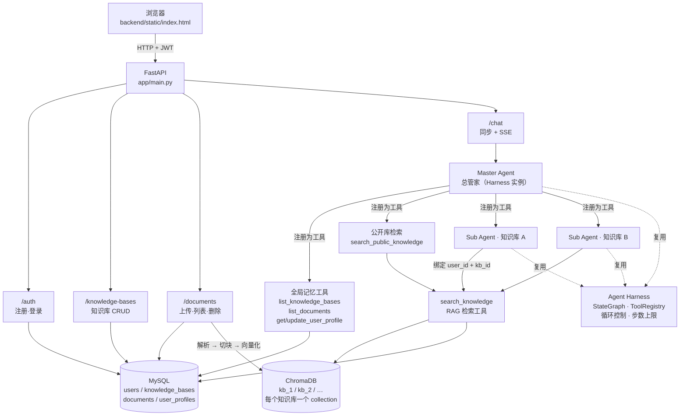
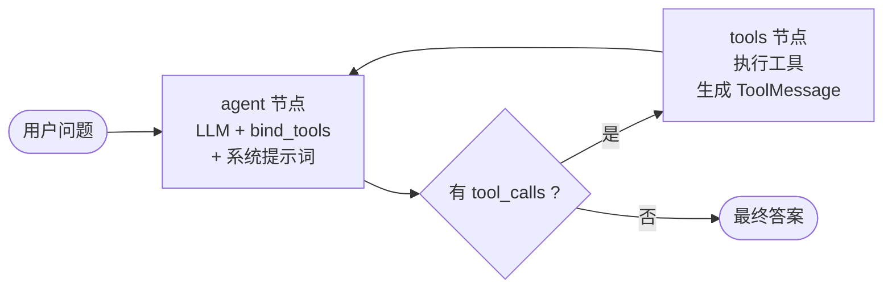

# MyJevis

基于 LangGraph 的多用户、多知识库 RAG 问答系统，内置一套轻量级可复用的 **Agent Harness**。

---

## 这个项目解决什么问题

常见的 RAG 项目通常是"一个知识库 + 一个问答接口"：文档全部塞进一个集合，检索时全库 top-k。这类做法在个人笔记场景够用，但一旦面对真实使用会有三个问题：

1. **多知识库无法隔离** —— 工作笔记和读书笔记混在同一个向量集合里，检索结果互相污染。
2. **多用户没有边界** —— 换个用户登录，仍能检索到别人的内容。
3. **问答是"黑盒一次调用"** —— 要么只能查，要么只能答，无法根据问题类型决定该不该查、该查哪个库。

MyJevis 的做法是把问答拆成两层 Agent：**Master Agent 负责判断"该问哪个知识库"，知识库 Sub-Agent 负责"在这个库里怎么查、怎么答"**。两个层级复用同一套 Harness，检索通过工具完成，工具在构建时绑定当前用户，权限不依赖 prompt。

**与普通单知识库 RAG 项目的区别**：

| 维度 | 普通单库 RAG | MyJevis |
|---|---|---|
| 知识组织 | 全局一个向量集合 | 每个知识库一个 collection，物理隔离 |
| 路由 | 无（全库检索） | Master Agent 按问题选择子 Agent |
| 权限 | 常缺 | 工具层闭包绑定 user_id，数据访问前校验 |
| 扩展方式 | 改检索函数 | 注册新工具，Harness 核心不动 |
| 数据一致性 | 少见处理 | MySQL 与 ChromaDB 的写入/删除成对处理 |

> 需要说明：这是一个**基于 LangGraph 封装的轻量执行层**，不是从零实现的 Agent 框架。图执行、状态管理、消息合并等能力由 LangGraph 提供，本项目负责的是工具注册、循环控制、上下文与权限注入、流式过滤这些工程化部分。

---

## 核心功能

**已实现**

- 多用户注册登录（JWT）
- 多知识库创建、重命名、公开/私有切换、删除
- 文档上传：`.txt` / `.md` / `.markdown` / `.docx` / **文本型** `.pdf`
- 文档列表查看与删除（删除时同步清理向量）
- RAG 检索问答，答案标注来源文件（PDF 附带页码）
- Master Agent 路由到知识库 Sub-Agent
- 公开知识库的跨用户动态检索
- 全局记忆：查询自己的知识库目录、文档清单、用户画像
- SSE 流式输出（只推送最终答案，不泄露中间过程）
- 可视化操作界面（单页 HTML，由 FastAPI 托管）

**未实现**（不要误认为已有）

- 扫描版 PDF 的 OCR
- 依赖前文的持久化多轮对话
- 文档内容的结构化引用 UI（页码已存，尚未在前端展示）

---

## 技术栈

| 层 | 选型 | 用途 |
|---|---|---|
| Web 框架 | FastAPI + Uvicorn | HTTP 接口、SSE 流式、静态托管 |
| Agent 编排 | LangGraph + LangChain | StateGraph 执行循环、消息管理 |
| 生成模型 | DeepSeek（deepseek-chat） | 对话与工具调用（OpenAI 兼容协议） |
| Embedding | 硅基流动 BAAI/bge-m3 | 文本向量化（多语言） |
| 向量库 | ChromaDB | 按知识库分 collection 的向量检索 |
| 业务库 | MySQL + SQLAlchemy | 用户、知识库、文档记录、用户画像 |
| 认证 | python-jose + bcrypt | JWT 签发与密码哈希 |
| 文档解析 | python-docx、pypdf | DOCX（含表格）、文本型 PDF |
| 前端 | Vue 3（本地文件）+ 原生 CSS | 单页应用，无构建步骤 |

---

## 系统架构



### 一次问答的走向

1. 前端带 JWT 调 `POST /chat/stream`。
2. 路由解析出 `user_id`，交给 `build_master_agent(user_id)` 构建总管家（按用户缓存）。
3. 总管家读工具清单，判断问题属于哪个知识库，调用对应的 `ask_kb_<id>` 工具。
4. 该工具内部是**另一个 Harness 实例**（子 Agent），它只有一把钥匙：绑定好 `kb_id` 和 `user_id` 的检索工具。
5. 子 Agent 调检索工具 → 查 Chroma → 命中片段带上来源与页码 → 生成答案。
6. 答案回到总管家，汇总后流式推给前端。

### 为什么每个知识库一个 Sub-Agent

- **职责分离**：总管家只做路由，子 Agent 只做本库检索，两边的 prompt 都很短，行为更稳定。
- **权限收敛**：子 Agent 的检索工具用闭包固定 `kb_id`，模型**没有参数可以指定别的库**。
- **代价**：一次提问模型被调用多次，延迟与 token 消耗高于单 Agent。适合知识库数量多、内容互不重叠的场景；只有一两个库时用单 Agent 更划算。

---

## Agent Harness 设计

Harness 位于 `backend/app/harness/`，六个文件，全部与业务无关：

| 文件 | 职责 |
|---|---|
| `config.py` | 从 `.env` 读取配置，启动时校验 JWT 密钥强度 |
| `llm.py` | 封装 ChatOpenAI 指向 DeepSeek，`@lru_cache` 复用实例 |
| `tools.py` | `ToolRegistry`：注册、去重、查询工具 |
| `state.py` | `AgentState`：`messages` + `add_messages` reducer |
| `graph.py` | ReAct 循环：agent 节点 / tools 节点 / 条件路由 |
| `harness.py` | 门面：`run()` 同步、`stream()` 流式、步数上限与降级 |

### 执行循环



- **agent 节点**：把系统提示词插到消息最前，连同历史消息一起交给模型；模型要么产出文本，要么产出 `tool_calls`。
- **tools 节点**：按 `tool_calls` 里的名字从注册表找工具执行，结果包成 `ToolMessage` 回填。
- **条件路由**：有 `tool_calls` 就去 tools，否则结束。tools 执行完无条件回到 agent。

### 三个工程化处理

**1. 重复工具调用防护**

`tools` 节点执行前，先统计历史里 `(工具名, 排序后的参数 JSON)` 出现过几次。同一组合超过阈值就不再真正执行，而是返回一条警告，让模型停止重复、改用已有信息回答。参数用 `sort_keys=True` 序列化，避免 `{"a":1,"b":2}` 和 `{"b":2,"a":1}` 被当成两次不同调用。

**2. 执行步数上限**

`graph.invoke(..., config={"recursion_limit": N})`。超过上限会抛 `GraphRecursionError`，Harness 捕获后返回一句友好说明，而不是把异常抛给用户。

> 实测记录：这个上限的计数语义和直觉不完全一致，所以项目里把它当**兜底**而不是**精确控制**。真正的收敛依靠模型自身判断——实测中模型在工具连续失败后会主动停止。

**3. 流式只输出最终答案**

`stream_mode="messages"` 会把图内**所有**消息都吐出来，包括工具检索到的原文。过滤规则（依据实测 metadata 得出）：

- 只处理 `AIMessageChunk`，`ToolMessage` 一律丢弃；
- 只接受 `langgraph_node == "agent"` 的事件；
- 带 `tool_calls` / `tool_call_chunks` 的消息属于中间轮次，其文本丢弃。

因为 token 先到、`tool_calls` 后到，无法边流边判断，所以按「消息」为单位缓冲，一条消息结束后再决定是否输出。**代价是最终答案整段出现而非逐 token**，这是"内容正确"优先于"实时感"的取舍。

### 身份与权限：闭包绑定

工具是全局注册的，模型并不知道"当前用户是谁"，也不该让它传 `user_id`——那等于把权限交给模型。

做法是在**构建工具时**用闭包固定：

```python
def make_search_knowledge(user_id: int):
    def search_knowledge(knowledge_base_id: int, query: str) -> str:
        require_readable_kb(knowledge_base_id, user_id)   # 数据访问前校验
        ...
    return search_knowledge
```

- 工具签名里**没有** `user_id`，模型无法指定或伪造。
- 不用 `contextvars`：流式响应会把同步生成器交给线程池迭代，上下文变量有丢失风险。
- 权限规则：读操作允许「本人 + 他人公开」，写操作只允许本人。

---

## 目录结构

```
my_jevis/
├── backend/
│   ├── app/
│   │   ├── harness/          可复用 Agent 运行时（业务无关）
│   │   │   ├── config.py
│   │   │   ├── llm.py
│   │   │   ├── tools.py
│   │   │   ├── state.py
│   │   │   ├── graph.py
│   │   │   └── harness.py
│   │   ├── knowledge/        RAG 与记忆业务
│   │   │   ├── embedding.py
│   │   │   ├── parser.py     多格式解析（txt/md/docx/pdf）
│   │   │   ├── store.py      ChromaDB 读写与删除
│   │   │   ├── tools.py      检索工具
│   │   │   ├── memory_tools.py
│   │   │   └── permissions.py
│   │   ├── agents/           多 Agent 编排
│   │   │   ├── sub_agent.py
│   │   │   ├── master_agent.py
│   │   │   └── public_search.py
│   │   ├── routers/          接口层
│   │   ├── registry.py       装配层：按用户构建工具注册表
│   │   ├── models.py         ORM 模型
│   │   ├── db.py             引擎、会话、建库建表
│   │   ├── auth.py           JWT 与密码哈希
│   │   ├── schemas.py        接口契约
│   │   └── main.py           应用入口
│   ├── static/               前端（单页，无构建步骤）
│   ├── tests/                pytest
│   ├── .env.example
│   └── requirements.txt
├── samples/                  示例知识文档（医药 / 财经，四种格式）
├── .gitignore
├── LICENSE
└── README.md
```

---

## 本地部署与运行

### 环境要求

- **Python 3.13**（项目在 3.13.18 上验证；3.11+ 理论上可用，未实测）
- **MySQL 8.x**（连接串使用 `pymysql`，字符集 `utf8mb4`）
- 可访问 DeepSeek API 与硅基流动 API 的网络

### 步骤

**1. 安装依赖**

```bash
cd backend
python -m venv .venv
# Windows: .venv\Scripts\activate
# macOS/Linux: source .venv/bin/activate
pip install -r requirements.txt
```

**2. 配置环境变量**

```bash
cp .env.example .env
```

然后编辑 `.env`，至少填这四项：

| 变量 | 说明 |
|---|---|
| `DEEPSEEK_API_KEY` | DeepSeek 控制台获取 |
| `EMBEDDING_API_KEY` | 硅基流动控制台获取 |
| `MYSQL_PASSWORD` | 你的 MySQL 密码 |
| `JWT_SECRET_KEY` | **至少 32 位随机字符串** |

生成 JWT 密钥：

```bash
python -c "import secrets; print(secrets.token_hex(32))"
```

> 启动时会校验：如果 `JWT_SECRET_KEY` 仍是占位值或短于 32 位，程序会**直接拒绝启动**并打印提示。这是有意设计——带着默认密钥跑起来比启动失败更危险。

**3. 数据库**

不需要手动建库建表。应用启动时 `init_db()` 会执行：

```sql
CREATE DATABASE IF NOT EXISTS my_jevis CHARACTER SET utf8mb4;
```

并自动建四张表（`users` / `knowledge_bases` / `documents` / `user_profiles`）。只要 `.env` 里的 MySQL 账号有建库权限即可。

**4. 启动**

```bash
cd backend
uvicorn app.main:app --host 127.0.0.1 --port 8000
```

打开 <http://127.0.0.1:8000> 使用界面，接口文档在 <http://127.0.0.1:8000/docs>。

**5. 运行测试**

```bash
cd backend
pytest tests/ -v
```

测试会自动切到独立数据库 `my_jevis_test` 和向量目录 `chroma_test/`（见 `tests/conftest.py`），**不会污染开发数据**。

> `tests/diag_stream.py` 和 `tests/diag_threshold.py` 是**人工诊断脚本**，不是自动化测试，不会被 pytest 收集。前者打印 LangGraph 的流式事件结构（用于设计输出过滤规则），后者实测 embedding 相似度分布（用于确定检索阈值）。两者都需要真实 API Key。

---

## 使用示例

1. **注册登录** —— 打开首页，注册一个账号，注册后自动登录。
2. **创建知识库** —— 左侧「+ 新建」，填名称与描述。描述建议写具体，公开库发现功能依赖它做语义匹配。
3. **上传文档** —— 选中知识库，点「上传文档」，支持 txt / md / docx / 文本型 pdf。
4. **提问** —— 直接输入问题。总管家会自动选库、检索、回答，答案带来源文件名。
5. **查看与管理** —— 点知识库右侧「⋯」→「管理文档」查看文件清单，可单个删除；「删除知识库」会连同文档与向量一起清除。
6. **公开/私有** —— 知识库右侧开关切换。设为公开后，其他账号可以检索到该库内容。

`samples/` 目录下有两组示例文档（医药、财经），覆盖四种格式，可直接用于验证。

> 截图占位：`docs/screenshots/`（待补充实际运行截图）

---

## 测试

```bash
cd backend && pytest tests/ -v
```

| 文件 | 覆盖内容 |
|---|---|
| `test_parser.py` | txt/md/docx/pdf 解析；DOCX 表格与块顺序；PDF 页码；空文档、损坏 PDF、扫描版、不支持格式被拒绝 |
| `test_permissions.py` | 跨用户私有库不可读；工具签名中不存在 user_id |
| `test_consistency.py` | 删除文档后检索不到；同名文件重复上传不覆盖 |
| `test_stream_filter.py` | 中间文本与工具原文不会出现在流式输出中 |
| `test_failure_modes.py` | 向量删除失败时接口 5xx 且 SQL 记录保留；解析失败不留记录；原始文件名保留 |

---

## 已知限制

- **PDF 仅支持文本层**：扫描版（纯图片）提取不到文本，会返回明确错误，不做 OCR。
- **PDF 的表格与排版不还原**：只提取纯文本，分栏、公式、表格结构会丢失。某页无文本时该页不产生 chunk，页码可能跳跃。
- **DOCX 只处理段落与基础表格**：图片、批注、修订、嵌套表格、浮动文本框不处理。
- **不支持 `.doc` 旧格式**。
- **无持久化多轮记忆**：每次请求只包含当前问题，不支持"它刚才说的那个"这类追问。
- **流式非逐 token**：为保证不泄露中间内容，最终答案按消息整段输出。
- **未做生产级并发验证**：单机开发环境通过，没有压测数据。
- **上传回滚只覆盖可捕获异常**：进程被强杀等极端情况仍可能残留向量。
- **Harness 基于 LangGraph**：图执行、状态管理由 LangGraph 提供，不是自研底层引擎。
- **向量数据不向后兼容**：如果从更早的版本升级，需要清空 `chroma/` 并重新上传文档（chunk metadata 结构变更过）。

---

## 开源协议

本项目采用 [MIT License](LICENSE)。

```
Copyright (c) 2026 QuJiang
```

可以自由使用、修改、分发和商用，只需保留版权声明与许可声明。

仓库内的 `backend/static/vue.global.prod.js` 是 [Vue 3](https://github.com/vuejs/core) 的官方发行文件（MIT License），一并内联是为了让前端不依赖外网 CDN，可离线运行。

---

## 致谢与说明

- Agent 循环、状态管理基于 [LangGraph](https://github.com/langchain-ai/langgraph)。
- 生成模型使用 [DeepSeek](https://www.deepseek.com/)，Embedding 使用 [硅基流动](https://siliconflow.cn/) 的 bge-m3。
- 本项目为个人学习与求职展示用途，示例文档内容为通用科普，不构成任何专业建议。
